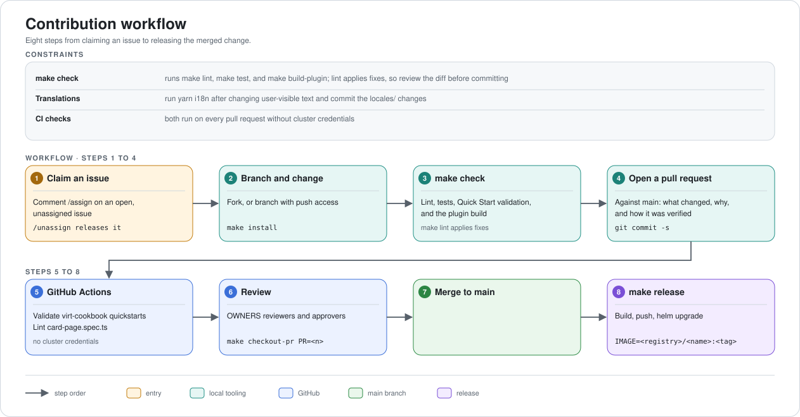

# Contributing

This guide covers the change workflow for the OpenShift Partner Labs Console
Plugin. The [README](README.md) covers what the plugin does and how to run and
deploy it.

```mermaid
flowchart LR
    claim["Claim an issue<br/>Comment /assign on an open, unassigned issue<br/>/unassign releases it"]
    change["Branch and change<br/>Fork, or branch with push access<br/>make install"]
    check["make check<br/>Lint, tests, Quick Start validation, and the plugin build<br/>make lint applies fixes"]
    pr["Open a pull request<br/>Against main: what changed, why, and how it was verified<br/>git commit -s"]
    ci["GitHub Actions<br/>Validate virt-cookbook quickstarts<br/>Lint card-page.spec.ts<br/>no cluster credentials"]
    review["Review<br/>OWNERS reviewers and approvers<br/>make checkout-pr PR=#lt;n#gt;"]
    merge["Merge to main"]
    release["make release<br/>Build, push, helm upgrade<br/>IMAGE=#lt;registry#gt;/#lt;name#gt;:#lt;tag#gt;"]
    claim --> change --> check --> pr --> ci --> review --> merge --> release
    %% make check runs make lint, make test, and make build-plugin; lint applies fixes, so review the diff before committing
    %% Translations: run yarn i18n after changing user-visible text and commit the locales/ changes
    %% CI checks: both run on every pull request without cluster credentials
```

Diagram source

## Prerequisites

- Node.js 24. `nvm use` reads [`.nvmrc`](.nvmrc).
- Yarn 4.18.0 is checked in under `.yarn/releases`. `make install` uses it; no
  global Yarn install is needed.
- Helm 3.17 or newer. `yarn validate:quickstarts` renders the chart with it.
- Podman or Docker, `oc`, and the GitHub CLI (`gh`) for the image and pull
  request targets.

The [devcontainer](.devcontainer) definition provides this toolchain.

## Find work

Open issues are listed in the
[issue tracker](https://github.com/redhat-openshift-partner-labs/console-plugin/issues).
Comment `/assign` on an open, unassigned issue to claim it. Comment `/unassign`
to release it. The workflow in
[`.github/workflows/assign-issue.yml`](.github/workflows/assign-issue.yml)
handles both commands and replies on the issue when a claim is refused.

## Make a change

1. Fork the repository, or create a branch if you have push access.
2. Run `make install`.
3. Make the change. For a new or changed walkthrough, follow the
   [ConsoleQuickStart demo guide](how-to-create-consolequickstart-demo.md).
4. Run `make check`. It runs `make lint`, `make test`, and `make build-plugin`.
   `make lint` applies fixes, so review the diff after it runs.
5. Run `yarn i18n` after adding or changing user-visible text and commit the
   `locales/` changes.
6. Verify the change in a Console. Run `yarn start` and `yarn start-console`
   against a cluster you are logged in to, or deploy with `make release`.
   Quick Start run controls need the Web Terminal; the local Console does not
   execute embedded commands.

### Repository constraints

- Components are TypeScript functional components with hooks.
- Styling uses PatternFly components and PatternFly CSS variables. The
  stylelint configuration rejects hex colors, element selectors, and `.pf-` or
  `.co-` class names. Prefix custom classes with the plugin name.
- Translated strings use the `plugin__console-demos-ocp-virtualization` namespace.
- Every `$codeRef` in [`console-extensions.json`](console-extensions.json) must
  match a key in `consolePlugin.exposedModules` in [`package.json`](package.json).
- Changes to `console-extensions.json` require restarting `yarn start`.

## Commit

Use a Conventional Commits prefix in the subject: `feat`, `fix`, `refactor`,
`docs`, `test`, `ci`, or `chore`, with an optional scope such as `feat(demos):`
or `fix(quickstarts):`.

Sign off each commit with `git commit -s`, which adds a `Signed-off-by` line
with the name and email from your Git configuration. This certifies the
[Developer Certificate of Origin](https://developercertificate.org/).

Keep each commit to one coherent, verified change. Update documentation in the
same change when behavior, configuration, or workflow changes.

## Open a pull request

Open the pull request against `main`. State what changed, why, and how it was
verified, including the OpenShift release used for any Console verification.

Two GitHub Actions checks run on every pull request:

| Check                              | Runs                                                                                          |
| ---------------------------------- | --------------------------------------------------------------------------------------------- |
| Validate virt-cookbook quickstarts | Type-checks and lints `scripts/`, runs `yarn validate:quickstarts`, then runs the unit tests. |
| Lint card-page.spec.ts             | Runs ESLint on the Playwright card page test.                                                 |

Both run without cluster credentials. Fix failures before requesting review.

## Review

Reviewers and approvers are listed in [OWNERS](OWNERS). A reviewer can check
out a pull request with `make checkout-pr PR=<number>` and deploy it to a test
cluster with `make deploy-pr PR=<number> IMAGE_REGISTRY=<registry>/<namespace>`.
Both targets require a clean working tree.

## Dependencies

Dependabot opens weekly grouped pull requests for npm packages and GitHub
Actions, prefixed `chore(deps)` and `ci(deps)`. The configuration is in
[`.github/dependabot.yml`](.github/dependabot.yml).
