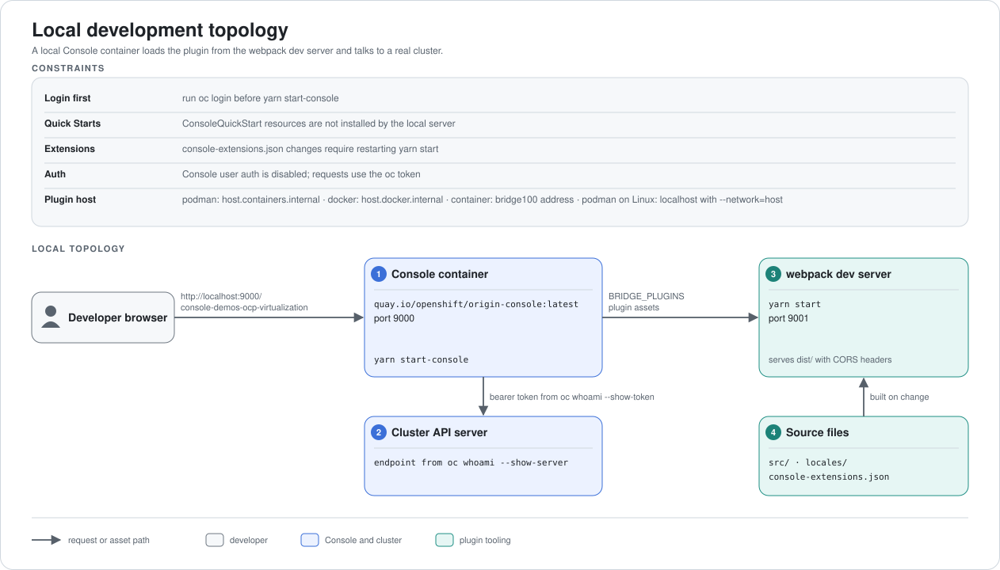
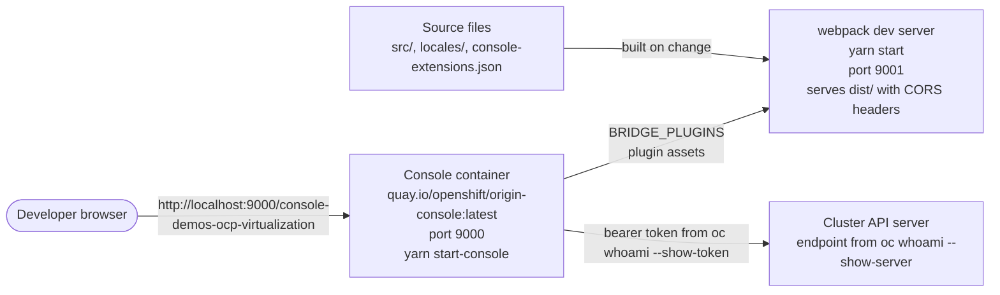
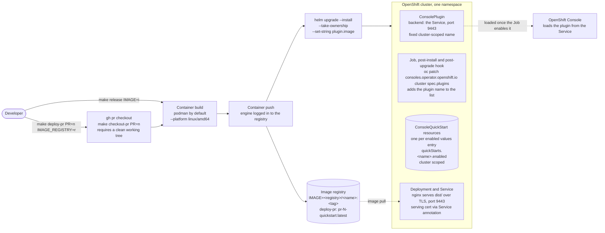

# OpenShift Partner Labs Console Plugin

This OpenShift Console dynamic plugin adds a **Virtualization Demos** page of
guided OpenShift Virtualization walkthroughs for partners evaluating the
product and for the contributors who write those walkthroughs.

## Cards

Each card on the page starts one `ConsoleQuickStart` walkthrough in the Console
Quick Start drawer. `src/cards.yaml` is the card registry, `src/data/cards.ts`
loads it, and `src/components/DemosPage.tsx` renders the gallery. The
`ConsoleQuickStart` templates live in
`charts/console-demos-ocp-virtualization/templates/virt-cookbook/`.

Each card shows a topic label and a duration label, and the toolbar filters by
topic. `src/data/topics.ts` defines the five topics:

| Topic       | Covers                                                                                                  |
| ----------- | ------------------------------------------------------------------------------------------------------- |
| Setup       | Installing OpenShift Virtualization and the LVM Storage Operator.                                       |
| Create VMs  | Creating VMs from the web console, CLI YAML, templates, instance types, cloud-init, and multiple disks. |
| Operate VMs | virtctl, lifecycle states, cloning, node placement, monitoring, and export and import.                  |
| Networking  | HTTPS Routes, NetworkPolicy, and static IP addresses.                                                   |
| Windows     | VirtIO drivers, golden images, and SSH access.                                                          |

The duration label reads `durationMinutes` from the card entry, which must
equal the resource's `spec.durationMinutes`; `yarn validate:quickstarts`
checks it.

## Requirements

| Requirement               | Version                                   | Needed for                                                                        |
| ------------------------- | ----------------------------------------- | --------------------------------------------------------------------------------- |
| OpenShift Console         | 4.19 or newer                             | Running the plugin. This build uses the 4.19 Console plugin SDK and PatternFly 6. |
| Node.js                   | 24, from `.nvmrc`                         | Building the plugin. The Docker image, CI, and devcontainer also use Node.js 24.  |
| Yarn                      | 4.18.0, checked in under `.yarn/releases` | `make install` and every `yarn` script.                                           |
| Helm                      | 3.17 or newer                             | `make deploy`, which passes `--take-ownership`, and `yarn validate:quickstarts`.  |
| `oc` with a cluster login |                                           | `yarn start-console` and deployment.                                              |
| Podman or Docker          |                                           | The local Console container and the image build.                                  |

The build supports the 4.19–4.21 compatibility router and the 4.22+ router
bridge. Console 4.22 changed its shared React, router, and i18n versions, so
validate the plugin on each Console release you deploy to.

Every card's walkthrough requires the `ConsoleQuickStart` resource installed by
the Helm chart. Running only the local plugin server installs none of them.

## Develop

1. Run `make install`.
2. Run `yarn start`. The webpack dev server listens on port 9001.
3. Run `oc login` against the cluster.
4. In another terminal, run `yarn start-console`.
5. Open <http://localhost:9000/console-demos-ocp-virtualization>.



<details>
<summary>Diagram source</summary>



</details>

Use the project selector above the Demos tabs to change the active Console
project. Activity shows the labeled resources in that project; **All projects**
shows none.

## Add content

To add a walkthrough card, follow the
[ConsoleQuickStart demo wiring guide](how-to-create-consolequickstart-demo.md).
Run `yarn i18n` after changing translated strings.

### Use as a template

This repository can be used as a template. Use GitHub's **Use this template**
action, then update plugin metadata, the i18n namespace, route paths, CSS
prefix, and Helm values.

## Check

Run `make help` to list the targets. `make check` runs linting, unit tests,
Quick Start validation, and the plugin build. `yarn lint` applies fixes, so
`make lint` and `make check` can change files.

## Deploy

```sh
make release IMAGE=quay.io/your-namespace/console-demos-ocp-virtualization:latest
```

`release` runs `build`, `push`, and `deploy` in order. Each target is also
available on its own, and `build-push` combines the first two. `deploy` runs
`helm upgrade --install` with `--take-ownership`, so existing `ConsoleQuickStart`
and related objects without Helm annotations are adopted into the release.


<details>
<summary>Diagram source</summary>



</details>

| Variable             | Default                                                                            | Used by                                                                    |
| -------------------- | ---------------------------------------------------------------------------------- | -------------------------------------------------------------------------- |
| `IMAGE`              | `<IMAGE_REGISTRY>/pr-<PR>-quickstart:latest` when both are set; otherwise required | `build`, `push`, `deploy`, `release`, `deploy-pr`                          |
| `IMAGE_REGISTRY`     | empty                                                                              | `deploy-pr`, to derive `IMAGE`                                             |
| `PR`                 | empty                                                                              | `checkout-pr`, `deploy-pr`                                                 |
| `PLATFORM`           | `linux/amd64`                                                                      | `build`; keep the default when building for amd64 nodes from Apple Silicon |
| `CONTAINER_ENGINE`   | `podman`                                                                           | `build`, `push`; set `docker` to use Docker                                |
| `RELEASE`            | `console-demos-ocp-virtualization`                                                 | `deploy`                                                                   |
| `NAMESPACE`          | `console-demos-ocp-virtualization`                                                 | `deploy`; created if missing                                               |
| `CHART`              | `charts/console-demos-ocp-virtualization`                                          | `deploy`                                                                   |
| `KUBE_CONTEXT`       | current kubeconfig context                                                         | `deploy`, as `--kube-context`                                              |
| `HELM`, `GH`, `YARN` | `helm`, `gh`, the checked-in Yarn release                                          | `deploy`; `checkout-pr`; `install`                                         |

Cluster-scoped chart resources such as the `ConsolePlugin` keep the fixed name
`console-demos-ocp-virtualization`, so a second release cannot adopt them.
Override `RELEASE` or `NAMESPACE` only when intentionally replacing a
non-default install.

Set `plugin.quickStarts.<name>.enabled=false` to omit one walkthrough's
`ConsoleQuickStart` resource. [`values.yaml`](charts/console-demos-ocp-virtualization/values.yaml)
lists every switch.

### Deploy a pull request to a test cluster

```sh
make deploy-pr PR=50 IMAGE_REGISTRY=quay.io/your-namespace
```

Preconditions:

- A clean working tree.
- The GitHub CLI (`gh`), authenticated.
- The container engine logged in to the registry.
- A cluster that can pull the image. Helm uses the current kubeconfig context
  unless `KUBE_CONTEXT` is set.

The target:

1. Checks out the pull request with `gh pr checkout`.
2. Builds and pushes `quay.io/your-namespace/pr-50-quickstart:latest`.
3. Upgrades the default release and namespace with `--take-ownership`.
4. Leaves the working tree on the pull request branch.

Set `IMAGE` to a full image reference to override the generated name.
Reviewers can check out a pull request without deploying with
`make checkout-pr PR=<number>`; it needs `gh` and a clean working tree.

## Contributing

[CONTRIBUTING.md](CONTRIBUTING.md) covers the change workflow, commit sign-off,
and the pull request checks.

## Diagram sources

The diagrams under `docs/images/` are hand-written SVGs built to
[docs/images/SVG-STYLE.md](docs/images/SVG-STYLE.md). The Mermaid source of
each figure is in the collapsed block under it.
