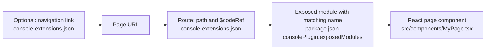

# OpenShift Partner Labs Console Plugin

This dynamic plugin adds a **Partner Labs Demos** page to the OpenShift Console.
The page has two tabs:

| Tab      | Content                                                                                                                                                   |
| -------- | --------------------------------------------------------------------------------------------------------------------------------------------------------- |
| Catalog  | One card per `ConsoleQuickStart` walkthrough, with a search box.                                                                                          |
| Activity | The `VirtualMachine` and `PipelineRun` resources in the selected project that carry the label `app.kubernetes.io/managed-by=partner-labs-console-plugin`. |

Use the project selector above the tabs to choose the project that Activity
lists. Activity lists nothing while **All projects** is selected.

`src/cards.yaml` is the card registry, and `src/data/cards.ts` loads it.
`src/components/DemosPage.tsx` renders the gallery and starts the selected
walkthrough. `ConsoleQuickStart` chart templates live in
`charts/partner-labs-console-plugin/templates/virt-cookbook/`.

To add a walkthrough card, follow the [ConsoleQuickStart demo wiring guide](how-to-create-consolequickstart-demo.md).

The route `$codeRef` values in `console-extensions.json` must match
`consolePlugin.exposedModules` in `package.json`. Run `yarn i18n` after changing
translated strings.

## Create a plugin page



Create the component, expose it under a name such as `MyPage`, and use that name
as the route's `$codeRef`. The route's `path` is the URL to open. To make the page
discoverable, add a navigation link whose `href` matches that path.

This repository can be used as a template. Use GitHub's **Use this template**
action, then update plugin metadata, the i18n namespace, route paths, CSS
prefix, and Helm values.

## Requirements

- OpenShift Console 4.19 or newer. This build uses the 4.19 Console plugin SDK
  and PatternFly 6. It supports the 4.19–4.21 compatibility router and the
  4.22+ router bridge.
  Console 4.22 changed its shared React, router, and i18n versions, so validate
  the plugin on each Console release you deploy to.
- Node.js 24 and Yarn 4 for building the plugin. Use the version in `.nvmrc`
  for local development; the Docker image, CI, and devcontainer also use Node.js 24.
- An OpenShift cluster and `oc` login for running it in the console.

Each card requires its `ConsoleQuickStart` resource, which the Helm chart
installs. Running only the local plugin server does not install those resources.

## Develop

```sh
make install
yarn start
```

After `oc login`, run `yarn start-console` in another terminal and open
<http://localhost:9000/partner-labs-demos>.

Run `make help` to see the available workflows. `make check` runs linting,
unit tests, Quick Start validation, and the plugin build. Note that the existing
`yarn lint` script applies fixes, so `make lint` and `make check` can update
files.

## Deploy

Build, push, and deploy an image in order with `make release`:

```sh
make release IMAGE=quay.io/your-namespace/partner-labs-console-plugin:latest
```

The `build`, `push`, and `deploy` targets are also available individually;
`make build-push` combines the first two. The container engine defaults to
Podman; set `CONTAINER_ENGINE=docker` to use Docker. The build platform defaults
to `linux/amd64`, which is useful when building for amd64 OpenShift nodes from
Apple Silicon. The release and namespace default to
`partner-labs-console-plugin`; override them with `RELEASE` and `NAMESPACE`.
Set `KUBE_CONTEXT` to select a specific cluster context for deployment.

Deploy a pull request to a test cluster with one target:

```sh
make deploy-pr PR=50 IMAGE_REGISTRY=quay.io/your-namespace
```

This checks out the PR, builds and pushes
`quay.io/your-namespace/pr-50-quickstart:latest`, then upgrades the default Helm
release and namespace (`partner-labs-console-plugin`). Cluster-scoped chart
resources such as `ConsolePlugin` keep that fixed name, so a separate PR release
cannot adopt them. Deploy uses Helm `--take-ownership` so existing
`ConsoleQuickStart` and related objects without Helm annotations can be adopted
into that release. Override `RELEASE` or `NAMESPACE` only when intentionally
replacing a non-default install. Helm uses the current context from
`KUBECONFIG` or the default kubeconfig; set `KUBE_CONTEXT` only to override that
context. The working tree must be clean, and the selected container engine must
be logged in to the image registry; the cluster must be able to pull the image.
The target leaves the working tree checked out to the PR. Set `IMAGE` to a full
image reference to override the generated image name. Requires Helm 3.17+.

Reviewers can check out a pull request with `make checkout-pr PR=<number>`.
This target requires the GitHub CLI and a clean working tree.

Set `plugin.quickStarts.vm-instancetypes-and-preferences.enabled=false` to omit the
walkthrough resource.

The **Create a VM from the web console** card launches the `create-vm-web-console`
Quick Start, adapted from the VM cookbook's `create-vm-web-console.adoc`. It covers
template selection, customization, provisioning, console access, lifecycle
operations, monitoring, and optional cleanup. Set
`plugin.quickStarts.create-vm-web-console.enabled=false` to omit its resource.

The **Create custom VM templates** card launches the `vm-templates` Quick Start,
adapted from the VM cookbook's `vm-templates.adoc`. It covers CLI template
inspection, baseline VM deployment, custom template registration, parameter
processing, guest login, and cleanup of a dedicated tutorial project. Set
`plugin.quickStarts.vm-templates.enabled=false` to omit its resource.

### Upgrade from a version with pipeline and cookbook cards

Earlier versions created cluster resources from the Demos page. The Activity tab
lists the labeled ones one project at a time. List them across all projects:

```sh
oc get virtualmachines --all-namespaces -l app.kubernetes.io/managed-by=partner-labs-console-plugin
oc get pipelineruns --all-namespaces -l app.kubernetes.io/managed-by=partner-labs-console-plugin
```

Each command reports an unknown resource type when OpenShift Virtualization or
OpenShift Pipelines is not installed.

The cookbook pages also created these resources without that label:

| Resource                              | Location                                        |
| ------------------------------------- | ----------------------------------------------- |
| Project `template-example`            | Cluster                                         |
| Project `vm-cloning-demo`             | Cluster                                         |
| `Template` `rhel9-custom`             | The project that was active when it was created |
| `DataVolume` `webserver-clone-2-disk` | Project `vm-cloning-demo`                       |
