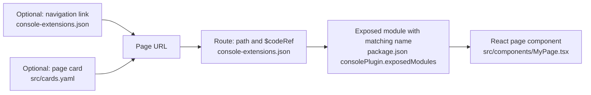

# OpenShift Partner Labs Console Plugin

This dynamic plugin demonstrates three ways a card can act in the OpenShift Console:

| Interaction         | Cards                                                                                        | Implementation                                                                                |
| ------------------- | -------------------------------------------------------------------------------------------- | --------------------------------------------------------------------------------------------- |
| Open a plugin page  | Custom Page, How-to Use Demos, Creating Virtual Machines, Custom VM Templates                | `console-extensions.json`, `src/components/ExamplePage.tsx`, `src/cookbook/`                  |
| Start a walkthrough | Create a VM from the web console, Create custom VM templates, VM Instancetypes & Preferences | `src/components/DemosPage.tsx`, `charts/partner-labs-console-plugin/templates/virt-cookbook/` |
| Trigger a pipeline  | Tekton Pipeline                                                                              | `src/components/DemosPage.tsx`                                                                |

`src/cards.yaml` is the sparse card registry. Each long cookbook body lives in
`src/cookbook/content/`; `src/data/cards.ts` loads card metadata, and the cookbook
page loads the matching content. The renderer, command runner, and content types
live in `src/cookbook/`. More VM-specific
`ConsoleQuickStart` chart templates for that cookbook belong in
`charts/partner-labs-console-plugin/templates/virt-cookbook/`.

To add a walkthrough card, follow the [ConsoleQuickStart demo wiring guide](how-to-create-consolequickstart-demo.md).

Use the project selector above the Demos tabs to change the active Console
project. The pipeline runs in that project, and Activity shows its resources.
Choose a specific project to enable the pipeline; **All projects** cannot run it.
Project switching is disabled while a pipeline creation request is pending.

The Custom Page demonstrates `useActiveNamespace`, `k8sListItems`,
`useK8sWatchResource`, `useUserSettings`, `useQuickStartContext`, `ResourceLink`,
and `Timestamp`. It shows copyable `oc` commands for the optional Web Terminal;
the page itself reads resources through the Console SDK and does not execute a shell.

The route `$codeRef` values in `console-extensions.json` must match
`consolePlugin.exposedModules` in `package.json`. Run `yarn i18n` after changing
translated strings.

## Create a plugin page



Create the component, expose it under a name such as `MyPage`, and use that name
as the route's `$codeRef`. The route's `path` is the URL to open. To make the page
discoverable, add a navigation link or a `kind: page` card whose URL matches that
path. `ExamplePage` at `/partner-labs-example` is the existing example.

This repository can be used as a template. Use GitHub's **Use this template**
action, then update plugin metadata, the i18n namespace, route paths, CSS
prefix, and Helm values.

## Requirements

- OpenShift Console 4.19 or newer. This build uses the 4.19 Console plugin SDK
  and PatternFly 6. It supports the 4.19–4.21 compatibility router and the
  4.22+ router bridge.
  Console 4.22 changed its shared React, router, and i18n versions, so validate
  the plugin on each Console release you deploy to.
- Node.js 24 and Yarn 4 for building the plugin. Use the version in `.nvmrc`
  for local development; the Docker image, CI, and devcontainer also use Node.js 24.
- An OpenShift cluster and `oc` login for running it in the console.
- OpenShift Pipelines for the Tekton card. The user needs permission to create
  `PipelineRun` resources in the active namespace. The cluster must be able to
  pull `registry.access.redhat.com/ubi9/ubi-minimal:latest`.

The walkthrough card requires the `ConsoleQuickStart` resource installed by the
Helm chart. Running only the local plugin server does not install that resource.

## Develop

```sh
make install
yarn start
```

After `oc login`, run `yarn start-console` in another terminal and open
<http://localhost:9000/partner-labs-demos>.

Run `make help` to see the available workflows. `make check` runs linting,
unit tests, Quick Start validation, and the plugin build. Note that the existing
`yarn lint` script applies fixes, so `make lint` and `make check` can update
files.

## Deploy

Build, push, and deploy an image in order with `make release`:

```sh
make release IMAGE=quay.io/your-namespace/partner-labs-console-plugin:latest
```

The `build`, `push`, and `deploy` targets are also available individually;
`make build-push` combines the first two. The container engine defaults to
Podman; set `CONTAINER_ENGINE=docker` to use Docker. The build platform defaults
to `linux/amd64`, which is useful when building for amd64 OpenShift nodes from
Apple Silicon. The release and namespace default to
`partner-labs-console-plugin`; override them with `RELEASE` and `NAMESPACE`.
Set `KUBE_CONTEXT` to select a specific cluster context for deployment.

Deploy a pull request to a test cluster with one target:

```sh
make deploy-pr PR=50 IMAGE_REGISTRY=quay.io/your-namespace
```

This checks out the PR, builds and pushes
`quay.io/your-namespace/pr-50-quickstart:latest`, then deploys it with a PR-specific
Helm release and namespace. Helm uses the current context from `KUBECONFIG` or
the default kubeconfig; set `KUBE_CONTEXT` only to override that context. The
working tree must be clean, and the selected container engine must be logged in
to the image registry; the cluster must be able to pull the image. The target
leaves the working tree checked out to the PR. Set `IMAGE` to a full image
reference to override the generated image name. The PR-specific deployment stays
available for manual review until its release and namespace are removed.

Reviewers can check out a pull request with `make checkout-pr PR=<number>`.
This target requires the GitHub CLI and a clean working tree.

Set `plugin.quickStarts.vm-instancetypes-and-preferences.enabled=false` to omit the
walkthrough resource.

The **Create a VM from the web console** card launches the `create-vm-web-console`
Quick Start, adapted from the VM cookbook's `create-vm-web-console.adoc`. It covers
template selection, customization, provisioning, console access, lifecycle
operations, monitoring, and optional cleanup. Set
`plugin.quickStarts.create-vm-web-console.enabled=false` to omit its resource.

The **Create custom VM templates** card launches the `vm-templates` Quick Start,
adapted from the VM cookbook's `vm-templates.adoc`. It covers CLI template
inspection, baseline VM deployment, custom template registration, parameter
processing, guest login, and cleanup of a dedicated tutorial project. Set
`plugin.quickStarts.vm-templates.enabled=false` to omit its resource.
